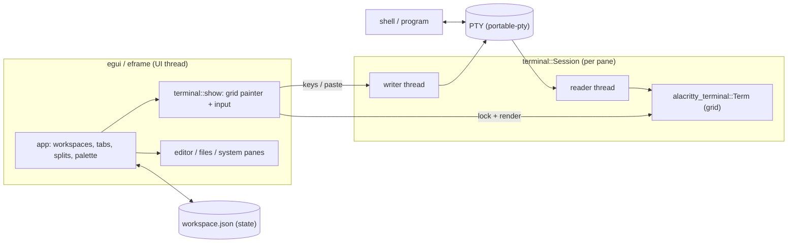

<p align="center">
  <picture>
    <source media="(prefers-color-scheme: dark)" srcset="assets/brand/mark-dark.svg">
    
  </picture>
</p>

```text
   ____    _    _____ _    _   _ __  __
  / ___|  / \  | ____| |  | | | |  \/  |
 | |     / _ \ |  _| | |  | | | | |\/| |
 | |___ / ___ \| |___| |__| |_| | |  | |
  \____/_/   \_\_____|_____\___/|_|  |_|   · rs
```

<p align="center"><strong>Your space to build.</strong><br>A native workspace terminal for Linux, macOS and Windows, built in Rust.</p>

Caelum uses egui/eframe for the interface, Alacritty's terminal core
(`alacritty_terminal`) for terminal semantics, and `portable-pty` for real shell
sessions. It is a single Rust binary with no browser engine or scripting runtime.

This is an early release: the remaining gaps are listed in
[docs/migration.md](docs/migration.md). No performance claims are made; see
[docs/benchmarks.md](docs/benchmarks.md) for the methodology and what has (and has
not) been measured.

## Architecture



Module boundaries are described in [docs/architecture.md](docs/architecture.md).

## Features

| Area | What works today |
| --- | --- |
| Terminal | ANSI, 256-color and true-color, alternate screen, scrollback, selection, copy, bracketed paste, scrollback search, OSC 8 hyperlinks |
| Layout | Workspaces, tabs, nested resizable splits, pane zoom |
| Editor | UTF-8 editing with syntax highlighting, external-change checks, atomic saves, recovery snapshots |
| Themes | Eleven bundled themes, custom color editor with live preview, JSON import/export |
| Tools | File browser, live Linux memory / load / uptime / process views |
| Remote | SSH through your existing client and configuration |
| Misc | Command palette, hidden-by-default sidebar, optional legacy workspace import |

## Keybindings

| Shortcut | Action |
| --- | --- |
| Ctrl+Shift+P | Command palette |
| Ctrl+Shift+B | Show / hide the sidebar (hidden by default) |
| Ctrl+Shift+T | New tab |
| Ctrl+Tab / Ctrl+Shift+Tab | Next / previous tab |
| Ctrl+Shift+D / E | Split right / below |
| Ctrl+Shift+Enter | Zoom / restore pane |
| Ctrl+Shift+W | Close pane |
| Ctrl+Shift+C / V | Copy selection / paste |
| Ctrl+Shift+F | Search terminal output and scrollback |
| Ctrl+O / Ctrl+S | Open / save file |

Double-click a tab to rename it, drag a divider to resize, and right-click a
terminal for copy/paste. Ctrl-click an OSC 8 HTTP(S) hyperlink to open it.

## Why Caelum

Caelum is young. This table states what each tool is built around so
you can pick the right one; it is not a ranking.

| | Caelum | tmux | Zellij | WezTerm | Ghostty |
| --- | --- | --- | --- | --- | --- |
| What it is | Terminal emulator with a built-in workspace UI | Terminal multiplexer (runs inside a terminal) | Terminal multiplexer / workspace (runs inside a terminal) | Terminal emulator with a built-in multiplexer | Terminal emulator |
| Tabs and splits | Yes, native GUI | Yes, in-terminal | Yes, in-terminal | Yes, native GUI | Yes, native GUI |
| Sessions survive closing the window | No (design notes: [docs/session-daemon.md](docs/session-daemon.md)) | Yes (detach / attach) | Yes (session resurrection) | Yes, via its mux server | No |
| Built-in file browser, text editor, system monitor panes | Yes | No | Not built in (plugins exist) | No | No |
| Image protocols (Sixel, Kitty, iTerm2) | No (design notes: [docs/image-protocols.md](docs/image-protocols.md)) | Depends on the host terminal and build | See project docs | Yes | Kitty graphics |
| Scripting / plugins | None | Shell scripting, plugins via TPM | WebAssembly plugins | Lua | None |
| Platforms | Linux (X11, Wayland), macOS, Windows | Unix-like | Unix-like | Linux, macOS, Windows | Linux, macOS |
| Maturity | Early (0.x) | Long-established | Established | Established | Established |

Where Caelum is a reasonable fit: one native window with terminal panes and a
few built-in tools, and no scripting runtime. Where it is not: persistent remote
sessions, image protocols or a plugin ecosystem. In those
cases tmux, Zellij, WezTerm or Ghostty are the better choice today. The comparison
reflects each project's public documentation; check their pages for current details.

## Build and run

Caelum targets Linux, macOS (universal DMG) and Windows (MSI + zip). Install a stable
Rust toolchain, a C linker and the usual OS runtime libraries. On Linux, fontconfig is
used to locate a system monospace font alongside eframe default fonts.

On Ubuntu, the runtime packages include `libxkbcommon-x11-0`, `libx11-6`,
`libwayland-client0`, `libegl1`, `libgl1` and `fontconfig`. On Arch, install
`libxkbcommon-x11`, `libx11`, `wayland`, `mesa` and `fontconfig`.

```sh
git clone https://github.com/DakodaStemen/caelum-rs.git
cd caelum-rs
cargo run --release --locked
```

To install, build once and run:

```sh
cargo build --release --locked
./scripts/install.sh
caelum-rs
```

The installer adds `~/.local/bin/caelum-rs` and a **Caelum Rust** app-menu entry.
It copies the binary, so rebuilding the checkout does not change the installed app.

## Settings and migration

The Rust workspace lives under `$XDG_DATA_HOME/caelum-rs/`, or
`~/.local/share/caelum-rs/` by default. Override it with `--data-dir PATH` or
`CAELUM_RS_DATA`. Each profile permits one running instance to avoid competing saves.

To import a **copy** of an existing workspace JSON into a fresh profile:

```sh
caelum-rs --import-legacy ~/.local/share/caelum/workspace.json
```

The source is read without modification. An existing destination workspace is
never overwritten. Browser URLs are retained as links opening in your system
browser. Shell working directories are restored, not the previous running processes
or terminal scrollback. Review [migration coverage](docs/migration.md) before importing.

Unsaved editor text is snapshotted in `drafts.json` every three seconds.
If a file changed on disk, conflicting recovery is archived in a
`drafts-conflict-*.json` file rather than written over that file.

## Development

```sh
cargo fmt --check
cargo clippy --locked --all-targets -- -D warnings
cargo test --locked
cargo build --release --locked

# Native in-app integration checks; uses an isolated profile and a plain shell.
mkdir -p .runtime
cargo run --locked -- --smoke-test "$PWD/.runtime/desktop.json"

# Actual X11 keyboard/mouse input and restart checks (requires X11 or Xvfb).
cargo test --locked --test desktop -- --ignored --nocapture
```

The smoke test writes a JSON report and PNG screenshot. It drives real PTYs and
native application actions; the separate XTest test drives real window input.
Neither test uses your normal Caelum profile or shell initialization files.

See [architecture](docs/architecture.md), [migration coverage](docs/migration.md),
and [contributing](CONTRIBUTING.md). The native terminal canvas still needs a full
screen-reader and IME compatibility audit; accessibility of ordinary UI controls
does not establish accessibility of terminal content.

## License

[MIT](LICENSE). Third-party crates retain their own licenses; see
[third-party notices](THIRD_PARTY_NOTICES.md). The icon is a clean SVG redraw of the supplied Caelum mark
without lettering; a heavier rendering is used at small app-icon sizes.
